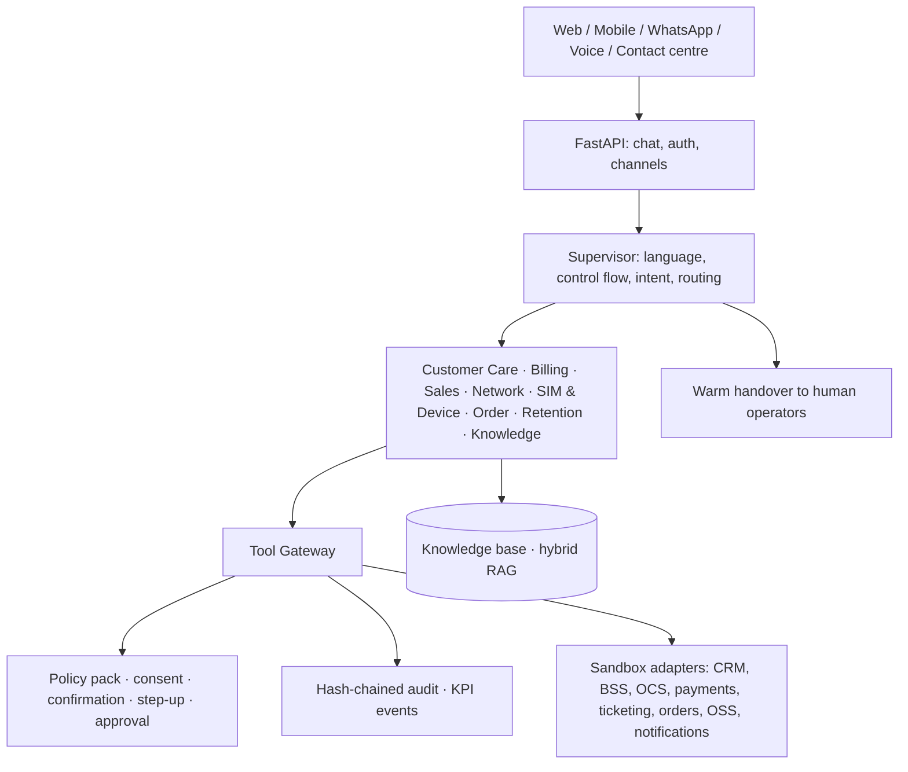
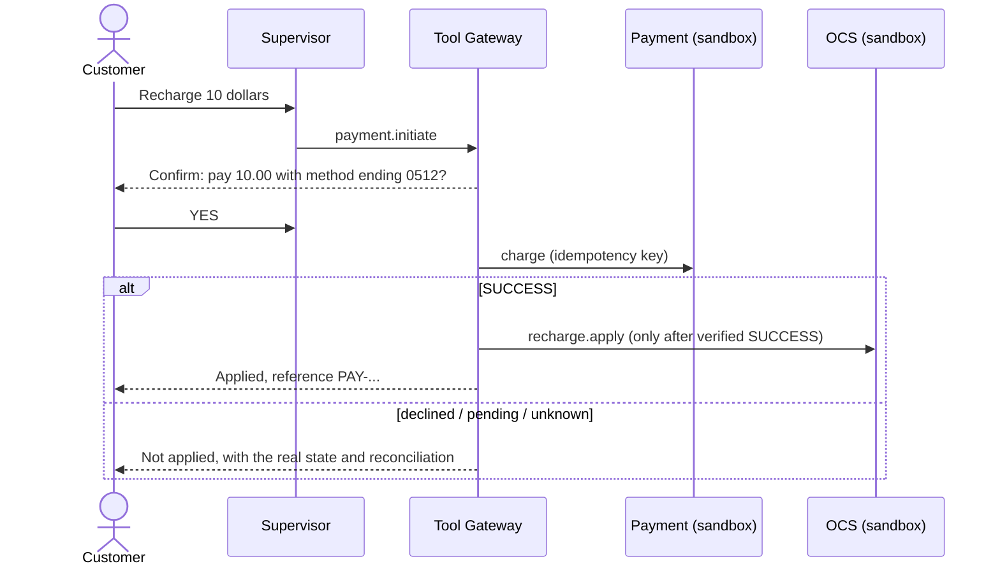

# BSP-CSC-RAG-Agent — Telecom Agentic Customer Experience Platform

[](https://github.com/sadiqgpasha89/BSP-CSC-RAG-Agent/actions)


-orange)

**Live project page:** <https://sadiqgpasha89.github.io/BSP-CSC-RAG-Agent/>

A multi-agent assistant for a telecom operator's consumer mobile and broadband care. It understands the request, retrieves grounded knowledge, reads live data **through a policy-enforcing tool gateway**, runs authorised transactions with explicit confirmation, and hands over to a human with full context when it should.

> **Read this first.** Every enterprise system here (CRM, billing, OCS, payments, ticketing, orders, OSS, notifications) is a **deterministic sandbox adapter**, labelled as such. No operator system is connected. The language-model layer is an interface with a deterministic mock by default; replies are built from structured tool results. Passing tests show that the orchestration, permission and safety logic works, not that a real integration does. See [Limitations](#limitations-and-what-is-not-done).

---

## What it does

| Area | Capabilities (all on sandbox adapters) |
|---|---|
| Account and care | Authentication, profile, services, history, complaints with consent, dedup, priority, case tracking, contact preferences |
| Usage and billing | Prepaid balance and usage, invoice retrieval, itemised explanation with evidence references, dispute registration, payment status and reconciliation |
| Payments | Recharge and bill payment with confirmation, idempotency, and safe handling of declined, pending, unknown and partially failed outcomes |
| Plans and retention | Discovery, comparison, eligibility and price check, plan and add-on change with read-back verification, legacy-terms warning, retention offers within policy |
| Network | Outage check, mobile and broadband diagnostics, technical tickets, consent-aware proactive outage and restoration notices |
| SIM and number | SIM/eSIM assistance, replacement, eSIM issue and porting with OTP step-up and human approval |
| Orders | Order, delivery, installation appointment and provisioning status |
| Human handover | Summary, priority, suggested next action, transcript, claim/reply/resolve, customer sees who is taking over |
| Governance | Deny-by-default policy pack, least-privilege agent matrix, hash-chained audit log, consent per purpose, operator approvals, KPI service |
| Channels and language | Web chat page, WhatsApp / voice / contact-centre adapters, English, Spanish and Hindi framing |

Scope follows [the build plan](#how-this-repo-relates-to-the-plan); per-item status is in [`IMPLEMENTATION_STATUS.md`](./IMPLEMENTATION_STATUS.md).

## Architecture



The design rule: **agents and any language model only propose; the gateway decides.** More diagrams (components, agent topology, ten sequence diagrams, class, ER, deployment, state machines, threat-model DFD) are in [`diagrams/`](./diagrams/README.md).

### Safety properties (each has tests)

- A session belongs to one customer; another customer's session id or confirmation id never works.
- Every tool call is validated server-side: typed arguments, no other-customer identifiers, scope, policy.
- Money and account changes need a **single-use confirmation** that expires and is cancelled by any new request.
- SIM/eSIM/porting need OTP step-up (3 attempts, then lock and handover) **and** human approval. Credits are never autonomous.
- A payment is reported as successful only when the provider confirms; pending, timeout and unknown states are explained and reconciled, never retried blindly or reported as paid.
- Plan and add-on changes are read back from the system before "Done".
- No tool can change live network infrastructure.
- Prompt-injection strings, privilege claims and OTP brute force do not widen access; audit masks card numbers, PINs and codes and detects tampering.

### Journey example: recharge



## Quickstart

```bash
git clone https://github.com/sadiqgpasha89/BSP-CSC-RAG-Agent && cd BSP-CSC-RAG-Agent
python -m venv .venv && source .venv/bin/activate
pip install -r requirements.txt
cp .env.example .env            # ENVIRONMENT=development needs no keys
make run                        # or: python -m uvicorn src.api.app:app --port 8000
```

- Customer chat: <http://localhost:8000/customer> (sign in as `SUB-882194` or `SUB-556201`; sandbox PIN shown on the page)
- Operator console: <http://localhost:8000/> (handover queue, approvals, **Measured KPIs** tab)
- API docs: <http://localhost:8000/docs>
- Tests: `make test` (or `python -m pytest tests -q`)
- Diagrams: `make diagrams` (needs `@mermaid-js/mermaid-cli`)
- Deploy to Google Cloud Run: `PROJECT_ID=... bash deploy/cloudrun/deploy.sh` (see [Deployment](./docs/DEPLOYMENT.md); Vercel is not suitable while state is in memory)

Try these in the chat page: "Explain my bill", "Recharge $10", "I want to change my plan to 5G Ultra Max", "I need a SIM replacement, new ICCID 8901234567890123456" (then enter the code the sandbox sends), "My internet is down", "I want to complain about poor service", "Talk to a human". Payment method ids `pm_decline`, `pm_pending`, `pm_timeout` reproduce failure paths in tests.

### Configuration

| Variable | Purpose |
|---|---|
| `ENVIRONMENT` | `development` (open console) or anything else (requires keys) |
| `SECRET_KEY`, `ADMIN_API_KEY` | Required outside development; operators send `X-API-Key` |
| `CORS_ALLOWED_ORIGINS` | Allowed browser origins |
| `LLM_PROVIDER` (`mock` or `openai_compatible`), `LLM_ENDPOINT`, `LLM_MODEL`, `LLM_API_KEY` | Optional phrasing layer; default mock |
| `WHATSAPP_APP_SECRET`, `WHATSAPP_VERIFY_TOKEN` | WhatsApp webhook; refused without a secret outside development |
| `DATA_DIR` | Relocate data files |

Policies live in [`config/policies.json`](./config/policies.json): actions, risk, assurance, limits, per-agent permissions, consent defaults, complaint SLAs.

## Repository map

| Path | Contents |
|---|---|
| `src/agents/` | Supervisor and eight specialist agents |
| `src/tools/` | Tool gateway and sandbox adapters |
| `src/workflows/` | YES/NO, OTP, consent and resumption control flow; payment workflow |
| `src/core/` | Auth, policy, confirmations, consent, conversations, audit, i18n, proactive notices |
| `src/rag/`, `src/data_engineering/` | Hybrid retrieval, ingestion, event buffer |
| `src/hitl/`, `src/channels/`, `src/metrics/`, `src/llm/` | Handover, channel adapters, KPI service, LLM interface |
| `src/api/`, `src/frontend/` | Routers; operator console and customer chat page |
| `config/`, `data/` | Policy pack; sandbox data and knowledge base |
| `tests/` | `unit`, `integration`, `security`, `edge_case`, `performance` |
| `diagrams/` | 18 Mermaid diagrams with rendered SVG |
| `docs/` | Specifications and operations (below) |

## Documentation

| Document | Audience |
|---|---|
| [BRD](./docs/BRD.md) | Business need, scope, rules, risks, compliance review items |
| [FSD](./docs/FSD.md) | Functional behaviour per capability |
| [TSD](./docs/TSD.md) | Stack, pipeline, gateway, adapter replacement points, configuration |
| [SADR](./docs/SADR.md) | Architecture decision records (ADR-001 to ADR-014) |
| [Threat model](./docs/THREAT_MODEL.md) | Threats, mitigations, tests, residual risk |
| [API contracts](./docs/API_CONTRACTS.md) | Routes, auth, payload semantics |
| [KPI definitions](./docs/KPI_DEFINITIONS.md) | Formulas, caveats, baseline plan |
| [Deployment](./docs/DEPLOYMENT.md) | Cloud Run vs Vercel decision, deploy steps, limits |
| [Runbook](./docs/RUNBOOK.md) | Run, configure, monitor, incidents, release |
| [Implementation status](./IMPLEMENTATION_STATUS.md) | Every plan item: status, code path, test path, gap |
| [Archive](./docs/archive/) | Earlier architecture spec and engineering article (historical) |

## KPIs

`GET /api/v1/admin/kpis` computes containment, first-contact resolution, task completion (verified outcome), handling time, CSAT, API execution success, escalation rate by reason, answer-accuracy proxy, payment success, cost per interaction, latency, abandonment, repeat contact, unsafe-action blocks, unsupported-answer rate and tool failure rate from audited events. With no data a KPI is `null` with a note. Containment is always shown beside completion, escalation reasons and CSAT. The older "6-category metrics" tab contains illustrative demo values and is labelled that way.

## Testing

148 tests: 147 passed in the environment where this was last run, which lacked FastAPI/httpx, so the two HTTP-route test files (`tests/integration/test_api_endpoints.py`, `test_api_hardening.py`) were **not executed** and the routes were only compile-checked. One logger test failed there because of that missing stack and is expected to pass in a full install, but this is unconfirmed. Run `make test` after `pip install -r requirements.txt` for the full picture. Not covered: browser end-to-end, load, accessibility audit, live-LLM evaluation.

## Limitations and what is not done

- All enterprise systems are mocks; replacement points are documented in the [TSD](./docs/TSD.md).
- State is in process memory: no persistence, no horizontal scaling, audit not durable.
- Login is a sandbox PIN; no OIDC/identity-provider integration.
- LLM provider interface and grounding wrapper exist but are not wired into replies and were not run against a live model.
- No speech-to-text/text-to-speech; the voice adapter takes text.
- No API rate limiting, OpenTelemetry export, RAG delete API, knowledge-source admin UI, or Kubernetes manifests. CI workflow and Dockerfile are provided but were not executed where this was written.
- Marketing consent is recorded and opt-outs honoured, but offers are not yet gated on it.
- Intent classification is lexical and tuned to the sandbox scenarios; Spanish and Hindi coverage is limited to the phrases it knows.
- Phase 4 (enterprise-wide operations, predictive maintenance, field service, B2B SLA, network automation) is deliberately **not** implemented.

## How this repo relates to the plan

This version expands the original hybrid-cloud RAG demo to the capabilities in the *Telecom Agentic AI Customer Experience Platform — Build Plan*: eight specialist agents, the tool gateway, the five priority journeys plus plan change, SIM/eSIM, orders and handover, consent and approval workflows, KPI instrumentation, channels, and documentation. The earlier retrieval, ML/NLP, MLOps, hybrid-router and network-console components are retained. Earlier design material moved to `docs/archive/`. Removed as not fitting: the training-time `alignment_pipeline` stub, the old provisioning agent (replaced by the SIM & Device and Order agents), and hard-coded CSAT/NPS/churn-equity figures (now measured or null).

## License

Apache-2.0 (see `pyproject.toml`).
