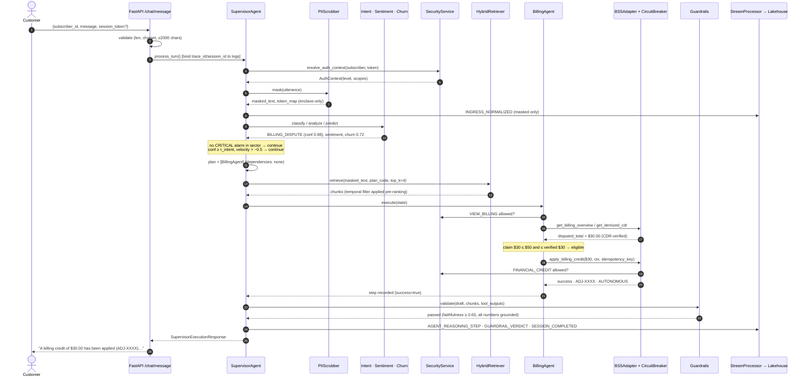
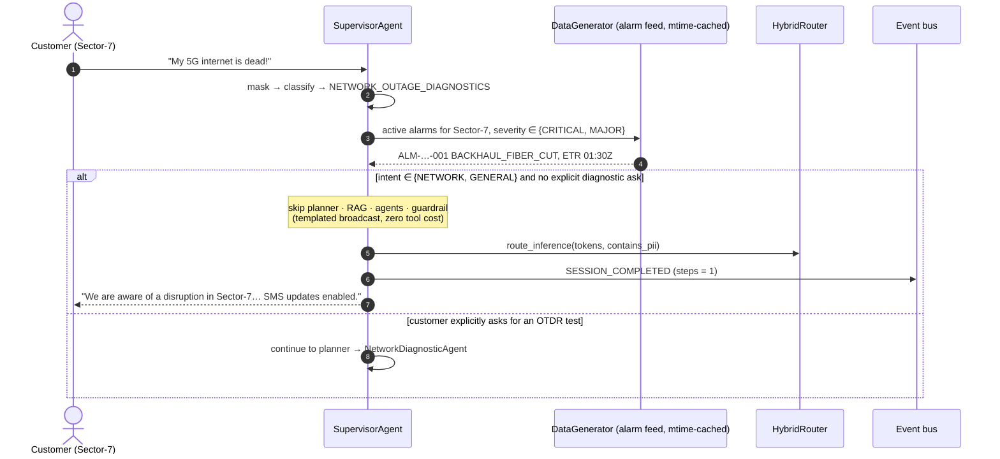
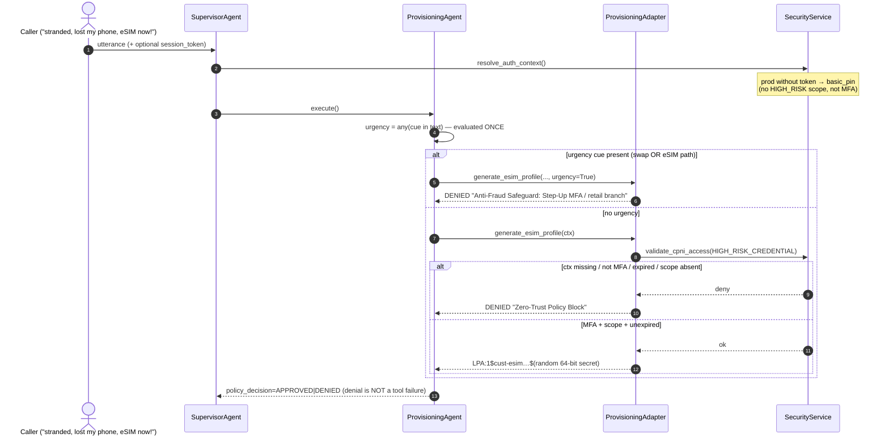
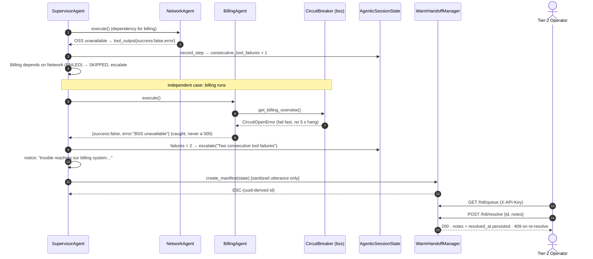
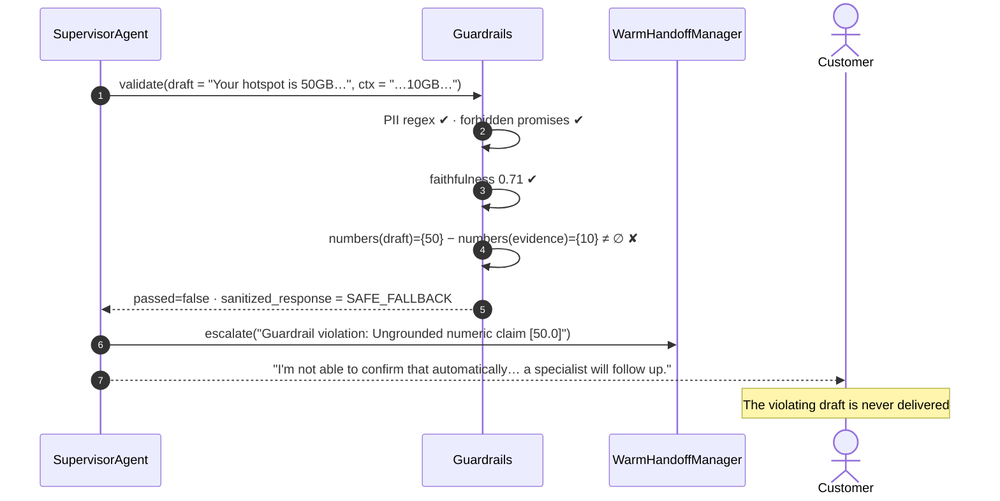

# Zero-Trust Agentic RAG for Telecom Support: Architecture, Sequence Flows, and the Bugs That Taught Me Where Agents Break

*A hybrid-cloud, multi-agent customer-support platform for a Tier-1 operator, and what a hard engineering review found inside it.*

---

**TL;DR**

- I built (and then stress-reviewed) an autonomous telecom support platform: PII/CPNI scrubbing, intent/sentiment/churn triage, a 4-tier hybrid RAG engine (dense + BM25 + GraphRAG + RRF fusion) with *contractual* temporal filtering, a supervisor-led multi-agent DAG, circuit-broken OSS/BSS tool adapters, a deterministic guardrail layer, human-in-the-loop (HITL) warm handoff, and an MLOps/LLMOps control plane.
- The central design rule: **the probabilistic parts propose, deterministic code disposes.** Every action that moves money, changes a SIM, or touches CPNI is gated by policy code that an LLM (or a clever customer) cannot talk its way past.
- A review pass found **30+ real defects**, several of them the kind that look fine in a demo and hurt in production: a classifier whose "confidence" was always 0.98, a guardrail that *blocked* responses and then *sent them anyway*, a billing agent that refunded every billing question, authentication that defaulted to MFA-verified, and stored XSS delivered through the human-escalation queue.
- After the fixes: 49 → **105 tests**, **91% coverage**, a verified fresh-clone build, and a browser-verified XSS fix. Code is in the repo; every fix has a regression test.

> **Honesty note up front.** This is a high-fidelity *reference implementation*. There are no live vLLM/Vertex calls: response synthesis is deterministic templating, "dense embeddings" are TF-IDF vectors, and the "neural reranker" is a lexical heuristic. The orchestration, policy, security and retrieval logic are real and tested; the model endpoints are stand-ins behind the same seams a production deployment would use. I'll flag exactly where.

---

## 1. Why telecom support is a uniquely hard agent problem

Most RAG demos answer questions. A telco support agent *takes actions on regulated systems*, under adversarial conditions, against legacy backends. Five constraints shaped everything:

| Constraint | What goes wrong with a naïve agent |
|---|---|
| **CPNI / PII regulation** (FCC CPNI rules, GDPR) | Card numbers, PINs and MSISDNs leak into prompts, logs, dossiers, public-cloud endpoints |
| **SIM-swap fraud** | An empathetic LLM hears "I'm stranded and lost my phone" and provisions an eSIM for an attacker |
| **Outage storms** | One fiber cut → 3,400 identical "my internet is dead" chats → GPU and OSS connection-pool exhaustion |
| **Grandfathered contracts** | Vector search surfaces the 2026 plan's 50 GB hotspot to a 2018 customer who contractually has 10 GB |
| **Legacy OSS/BSS** | A billing database that takes 15 s to answer hangs the agent or invites a hallucinated answer |

The architecture below is a direct response to those five failure modes, not a generic "agent + vector DB" stack.

---

## 2. System at a glance

```
                       Customer (chat / SMS / voice→ASR)
                                      │
                         POST /api/v1/chat/message           ← validated, size-bounded, 404 on unknown subscriber
                                      │
┌─────────────────────────────────────▼───────────────────────────────────────────────┐
│ SupervisorAgent.process_turn()   (trace_id + session_id bound into every log line)    │
│                                                                                       │
│ S1 INGRESS     ASR normaliser ─► PII/CPNI scrubber  (single-pass tokenisation)        │
│ S2 TRIAGE      Intent (softmax posterior) · Sentiment + velocity · Churn risk          │
│ S3 IDENTITY    HMAC session token ─► AuthContext ─► CPNI scope matrix (fail-closed)   │
│ S3b GEOFENCE   active CRITICAL/MAJOR alarm in subscriber's sector? ─► deflect, stop    │
│ S4 PLAN        one task per agent · priority = topological order · dependency edges   │
│ S5 RETRIEVE    temporal pre-filter ─► Dense ∥ BM25 ∥ GraphRAG ─► RRF ─► rerank         │
│ S6 EXECUTE     Network ─► Provisioning ─► Billing ─► Retention (loop + step guards)    │
│                    │            │            │                                        │
│              OSS adapter   Provisioning   BSS adapter        each wrapped in a         │
│                            adapter                           CircuitBreaker            │
│ S7 GUARDRAILS  PII/CPNI regex · forbidden promises · faithfulness · numeric grounding  │
│                 └── violation ⇒ draft WITHHELD, safe fallback sent, HITL escalation    │
│ S8 FINALISE    cost-arbitrage routing · trajectory + session events ─► lakehouse       │
└───────────────┬───────────────────────────────────────────────────┬───────────────────┘
                │ escalated?                                        │ always
                ▼                                                   ▼
     WarmHandoffManager (PII-safe dossier)               StreamProcessor ─► BigQuery sink
     /api/v1/hitl/*  (operator API key)                  ─► metrics engine (live-or-labelled)

 Control plane:  DriftDetector (PSI · KS · centroid · tool-ratio · RAG-ratio) ─► SelfHealingEngine
                 LLMOps evaluator · model registry · alignment (LoRA/DPO) config
```

### Module map

| Layer | Modules | Responsibility |
|---|---|---|
| API | `api/app.py`, `routes/*`, `deps.py` | Validation, CORS allow-list, operator auth, error hygiene |
| Orchestration | `agents/supervisor.py`, `state.py` | Plan-and-Solve DAG, blackboard, loop/step guards, escalation accumulation |
| Workers | `billing_agent`, `network_agent`, `provisioning_agent`, `retention_agent` | Domain logic; each emits an explicit `success` flag |
| Policy | `agents/guardrails.py`, `core/security.py` | Output validation; CPNI scope matrix; signed tokens |
| Retrieval | `rag/{vector_store,bm25_engine,graph_store,temporal_filter,hybrid_retriever}.py` | Hybrid retrieval with contractual isolation |
| Tools | `tools/{bss,oss,provisioning}_adapter.py`, `circuit_breaker.py` | Side-effecting calls behind resilience + policy |
| NLP | `datascience/*` | PII scrub, ASR normalisation, intent, sentiment, churn |
| Data plane | `data_engineering/*` | Ingestion, graph build, event bus, lakehouse sink |
| Ops | `mlops/*`, `llmops/*`, `metrics/*`, `core/hybrid_router.py` | Drift, self-healing, cost routing, KPI snapshot |

### Three design principles

1. **Fail closed.** Missing auth context → denied. Unknown plan → *no* legacy chunks. Unknown subscriber → 404, not a fabricated default profile. Production boot without a real `SECRET_KEY`/`ADMIN_API_KEY` → the process refuses to start.
2. **The agent cannot self-authorise.** A billing agent may auto-credit ≤ $50, and only up to what the CDRs *prove* is disputed. Anything else is a request to a human, not an action.
3. **Every claim must be traceable.** A numeric figure shown to a customer must exist in retrieved context or tool output, or the draft is withheld.

---

## 3. The request lifecycle, stage by stage

### Stage 1: Ingress and PII/CPNI scrubbing

For voice, the ASR normaliser rewrites code-switched phrases to canonical telecom concepts (`"activate nahi ho rahi"` → `"fails to activate"`) using longest-phrase-first, word-boundary substitution. Then the scrubber tokenises sensitive spans *before any reasoning layer sees the text*.

The scrubber is deliberately ordered most-specific-first (a 16-digit card must not be half-eaten by the 15-digit IMEI rule) and runs **single-pass `re.sub` with a callback**, not `str.replace(value, token)`:

```python
PATTERNS = [
  ("CREDIT_CARD", re.compile(r"\b(?:\d{4}[ -]?){3}\d{4}\b")),
  ("SSN",         re.compile(r"\b\d{3}-\d{2}-\d{4}\b")),
  ("ICCID",       re.compile(r"\b89\d{16,18}\b")),
  ("IMEI",        re.compile(r"\b\d{15}\b")),
  # lookarounds, not \b: \b never matches before "(" or "+"
  ("MSISDN",      re.compile(r"(?<![\w<])(?:\+?1[-. ]?)?(?:\([2-9]\d{2}\)|[2-9]\d{2})[-. ]?[2-9]\d{2}[-. ]?\d{4}(?![\w>])")),
]
```

The token map (`<CREDIT_CARD_1> → 4532…`) never leaves the enclave. Downstream components (planner instructions, trajectory events, HITL dossiers) only ever see `masked_text`. That last clause turned out to be less true than it looked, see §6.

### Stage 2: Triage: intent, sentiment, churn

**Intent** is a multi-label classifier whose job is to produce *calibrated* confidence, because confidence drives the first HITL trigger (τ_intent = 0.82). Evidence per intent is lexical match density; a temperature-scaled softmax turns evidence into a posterior; confidence is the **probability mass on the activated intents** (primary + secondaries), so a genuine multi-intent utterance isn't punished for being split:

```python
exp = {k: math.exp(v / 0.10) for k, v in raw_scores.items()}      # T = 0.10
probs = {k: e / sum(exp.values()) for k, e in exp.items()}
active = [primary] + [i for i in ranked[1:] if raw[i] / raw[primary] >= 0.65]
confidence = min(0.98, sum(probs[i] for i in active))
```

One strong keyword ≈ 0.88; two or more saturate at the 0.98 cap. If there is *no* domain evidence at all the class is `GENERAL_INQUIRY`, a catch-all selected by absence, with a fixed prior of 0.85; the retrieval-relevance gate (τ_rag = 0.70) protects the customer on that path instead.

**Sentiment** is lexicon-based; **frustration velocity** is the discrete derivative `v_t = s_t − s_{t−1}`. `v ≤ −0.5` triggers a *proactive* handoff before the customer rage-quits. **Churn** is an additive risk model (disputes, billing status, sentiment, outage exposure, tenure); `p > 0.75` pulls the Retention agent into the plan.

### Stage 3: Identity and CPNI authorisation

Assurance level determines scopes through an explicit least-privilege matrix:

| Auth level | Scopes |
|---|---|
| `unauthenticated` | none |
| `basic_pin` | view account, view billing |
| `authenticated_mfa` / `in_person_verified` | + view CDRs, modify services, **billing credit**, **SIM/credential change** |

Assurance is established by an HMAC-SHA256 signed session token (`subscriber:msisdn:level:ts:sig`, 2 h TTL, `compare_digest`, future-timestamp rejection) that is **bound to the subscriber**; a token minted for someone else is ignored. `AuthContext` defaults are fail-closed (`is_mfa_verified=False`, no scopes). In `ENVIRONMENT=development` the default level is MFA so the demo console works without a login flow; in every other environment the default is `basic_pin`, so privileged tools deny unless a valid token is presented.

### Stage 3b: Outage-storm geofence (spec §10.1)

Before any tool, retrieval or "LLM" work, the supervisor checks the subscriber's sector against the live alarm feed. If there is an active **CRITICAL/MAJOR** alarm and the intent is network/general (and the customer didn't explicitly ask for a diagnostic like an OTDR test), the turn is answered with a templated broadcast, one step, near-zero cost, and the session ends. A `MINOR` RF-attenuation warning does **not** count (it used to).

### Stage 4: Planning: a DAG, not a list

`_formulate_plan` builds **one task per agent** (intents that map to the same agent are deduplicated), orders them by a fixed priority that doubles as a topological order, and encodes the spec's intra-task dependencies as real edges:

- `Billing` depends on `Network` when both are present: *validate the outage before refunding for lack of service.*
- `Retention` depends on every other task: *formulate the offer last.*

At execution time a task whose prerequisite didn't `COMPLETE` is marked `SKIPPED` and the session escalates rather than running a refund against an unvalidated premise.

**Loop and runaway guards** (spec §10.4) run before every dispatch:

1. `step_count ≥ 6` → terminate + handoff.
2. Delegation history ends in `A,B,A,B` → terminate + handoff.
3. Same agent re-invoked with an **identical sub-goal** → terminate + handoff.
4. Two **consecutive tool failures** → handoff.

### Stage 5: 4-tier hybrid retrieval with contractual isolation

The ordering is the point: **metadata filters apply before ranking**, in every tier.

```
filters = temporal_filter(plan_code, query)
dense   = cosine(TF-IDF(query), chunks)  | filters     # stand-in for HNSW ANN
bm25    = Okapi(k1=1.5, b=0.75)          | filters     # exact acronyms / hex codes / model numbers
graph   = NetworkX k-hop neighbourhood   | filters     # topology + tariff entitlement edges
RRF(d)  = Σ_m  w_m / (60 + rank_m(d))                  # weights are tunable by self-healing
```

- **BM25** uses a telecom-aware tokeniser that preserves `ERR_NW_ATTACH_TIMEOUT_0x4F`, `GW-AX6000`, `fast.telco.net`, and strips trailing sentence punctuation (`"refund."` must match `refund`). IDF is Robertson–Spärck Jones: `ln(1 + (N − n + 0.5)/(n + 0.5))`. Term counts are precomputed at index time.
- **GraphRAG** matches entities by whole token (`TOWER-10` must not fire on `TOWER-104`) and by un-prefixed alias (`0x4F` → `ERR_CODE:0x4F`). Tariff nodes carry the *governing plan*, so the same filter that protects the vector tier protects the graph tier.
- **Zero-score results are dropped** in dense and sparse tiers; otherwise irrelevant chunks earn RRF credit just for occupying rank positions.
- **Reranker (simulated):** `min(0.99, rrf × 25 + min(0.35, 0.08 × query_overlap))`, a lexical stand-in for a cross-encoder. The seam is the `RetrievalResult.rerank_score` consumed by the τ_rag gate.

**The temporal rule.** `FREEDOM_UNLIMITED_2018` → `{plan_code: FREEDOM_UNLIMITED_2018}`; any other plan, *including unknown ones* → `{is_legacy: False}`; explicit comparison intents ("upgrade", "compare") lift the filter. `KnowledgeChunk.matches()` treats plan-agnostic chunks (SOPs, device manuals) as visible under any plan filter, so isolation doesn't also amputate troubleshooting knowledge.

### Stage 6: Tools: resilience *and* policy

**Circuit breaker** (spec §10.3). A `CLOSED → OPEN → HALF_OPEN` state machine, lock-guarded because FastAPI runs sync handlers in a thread pool, with *one* probe admitted in `HALF_OPEN`; a failed probe re-opens immediately. Open circuits raise a dedicated `CircuitOpenError` that agents catch and convert into a *recorded tool failure*, never a 500.

**BSS credit policy.** The adapter enforces: finite, strictly positive amounts; `FINANCIAL_CREDIT` CPNI scope; idempotency keys (a replayed turn returns the original `ADJ-…`, no double credit); and the hard $100 ceiling. The `BillingAgent` adds the part a rules engine can't skip:

| Request | Outcome |
|---|---|
| ≤ $50 **and** ≤ CDR-verified disputed total | Auto-credit (idempotent, scope-checked) |
| > $50, or exceeds what CDRs verify | `ESCALATION_REQUIRED`: supervisor approval; the agent *cannot* self-grant |
| > $100 | Hard ceiling → human |
| No refund language in the utterance | Informational answer only; **no credit** |

**Provisioning zero-trust.** Urgency/social-engineering cues (`stranded`, `emergency`, `lost phone`, `immediately`, `without pin`…) are evaluated **once** and applied to *every* credential-affecting path: SIM swap **and** eSIM re-profiling (functionally the same attack). Cues can only tighten policy. eSIM generation fails closed without an auth context, requires `HIGH_RISK_CREDENTIAL` scope, and the activation secret comes from `secrets.token_hex`, not a hash of public inputs and a clock.

### Stage 7: Guardrails (the deterministic last line)

Four checks, all on the evidence-derived draft:

1. **PII/CPNI regex** (PAN, SSN) in the *output*.
2. **Forbidden commitments** ("waive your entire bill forever").
3. **Faithfulness**: overlap of *informative* tokens (≥ 4 chars, stop-words removed, light stemming) with the evidence, scaled ×1.35, threshold 0.65.
4. **Numeric grounding**: every number the customer is shown must appear in retrieved context or tool output, compared as floats (`$30.00` ≡ `30.0`). This is the deterministic backstop for the legacy-plan trap: a draft that says `50GB` when the evidence says `10GB` cannot ship.

On any violation the verdict's `sanitized_response` is a **safe fallback**, the draft is withheld, and the session escalates. System-authored notices (identity prompts, "billing system unavailable") are appended *after* validation, because they make no factual claims about the account and would otherwise fail a lexical-overlap test.

### Stage 8: Telemetry and cost arbitrage

Each turn emits an `AGENT_REASONING_STEP` per step, a `GUARDRAIL_VERDICT`, and a `SESSION_COMPLETED` event on a bounded, thread-safe bus feeding a BigQuery-shaped sink. The hybrid router prices each turn: OpenStack vLLM amortised at \$0.00012/1k tokens vs Vertex at \$0.00125 in / \$0.00375 out, vs GKE burst. **Data residency is enforced in the router:** a session in which PII was detected stays on-prem even if it's complex enough to otherwise burst to GCP.

---

## 4. Sequence diagrams

*(Mermaid source. Paste into [mermaid.live](https://mermaid.live) and export PNG/SVG for Medium, which doesn't render Mermaid natively.)*

### 4.1 Happy path: verified billing dispute, auto-credit



### 4.2 Outage-storm geofence deflection



### 4.3 Zero-trust eSIM / SIM-swap



### 4.4 Degraded backend → circuit breaker → HITL



### 4.5 Guardrail veto



---

## 5. State, blackboard and the escalation model

`AgenticSessionState` is the shared blackboard *and* the audit trail: verified MSISDN, tier, plan, tower/sector, CLV, auth level, plus an append-only `execution_stack` of `ExecutionStep`s. Three details matter:

- **Escalation accumulates, never overwrites.** `state.escalate(reason)` joins distinct reasons with ` | `. Previously a later agent's reason silently replaced an earlier one, so the human saw the wrong root cause.
- **Failure is a first-class, explicit signal.** Every agent returns a top-level `success` flag. A zero-trust *denial* is a correct policy outcome (`policy_decision: DENIED`), not a tool failure, and must not count toward the two-failure trigger. A pure reasoning step must not *reset* the streak either.
- **HITL triggers** (spec §3.3) are all live: intent confidence < τ_intent; retrieval relevance < τ_rag (or *nothing* retrieved); two consecutive tool failures; guardrail violation; credit above autonomous limit; frustration velocity ≤ −0.5; step/loop guard.

The **warm-handoff dossier** carries: escalation reason, CLV, tier, verified identity state, chronological attempted actions (agent, tool, thought, SUCCESS/FAILURE/NONE), recommended representative actions, and a *sanitized* excerpt of what the customer said.

---

## 6. The engineering review: what was actually broken

I ran the original test suite first: 49 green. Then I stopped trusting green and **reproduced each suspected defect before touching code**. Here are the ones worth telling stories about.

### 6.1 "Confidence" that could never be low

```python
exp_scores = {k: v / max_score ...}          # divide every score by the max…
primary_conf = sorted_intents[0][1]          # …so the winner is always 1.0
confidence = min(0.98, primary_conf)         # → always 0.98
```

Reproduced: `"hello there"`, `"asdf qwerty"`, `"my bill is high"` all returned **0.98**. The τ_intent = 0.82 escalation (the first HITL trigger in the spec) was unreachable. Fixed with the softmax-posterior in §3 Stage 2; a regression test proves escalation *is* reachable by raising the threshold.

### 6.2 A guardrail that blocked, then delivered

`GuardrailVerdict.sanitized_response=clean_text` where `clean_text = response_text`: i.e. the unmodified draft. The UI printed "VIOLATION BLOCKED" while the customer received the exact text that was "blocked." Now a failed verdict returns a safe fallback and the supervisor escalates; the test asserts a card number never appears in the fallback.

### 6.3 Authentication that defaulted to "MFA verified"

`AuthContext` defaulted to `auth_level="authenticated_mfa", is_mfa_verified=True`, and the supervisor called `issue_default_auth_context` for *every* request, so the SIM-swap "zero-trust" check was always satisfied. Compounding it:

- `generate_esim_profile` only validated `if auth_context:` ⇒ **fail-open** on `None`.
- Urgency detection lived *only* in the explicit "SIM swap" branch, so *"I'm stranded, give me a new eSIM QR code"* sailed past the anti-fraud gate.
- Unknown subscriber IDs were given a fabricated default profile ($1,500 CLV, Sector-7) *and* the MFA context.

All four closed. Scopes now derive from assurance level; assurance comes from a signed, subscriber-bound token; production defaults to `basic_pin`.

### 6.4 The billing agent that refunded every billing question

The agent decided to refund by scanning *its own instruction string*:

```python
if any(w in task_instruction.lower() for w in ["credit", "dispute", "refund", ...]):
```

…and the planner built that instruction as `"Investigate billing charges and authorize credit for …"`. The word "credit" was always present. *"Why is my bill so high?"* → **$30 refund**, with `disputed_amount` silently defaulting to a magic `30.00`. Now: refund intent comes from the customer's (sanitized) words; the amount defaults to the CDR-verified total, never a constant; and the agent can only auto-approve what the records prove.

### 6.5 Stored XSS via the human-escalation queue, plus PII in the dossier

Two bugs that combine badly. The dossier's `root_cause_summary` was built from `state.raw_utterance`, so the **unmasked** card number/PIN was served by `/hitl/queue`. And the console rendered dossier fields with `innerHTML`. A customer typing `` into the chat produced a stored XSS that executes in the **supervisor's** browser, with operator privileges. Fixes: dossier uses the sanitized utterance; the console escapes every interpolated value; I verified in a real browser that the payload renders inert (0 injected `` nodes, no script execution).

### 6.6 Logging that silently ignored its own configuration

```python
def get_logger(name, trace_id=None):
    return structlog.get_logger(name).bind(trace_id=f"trc-{uuid...}")   # .bind() at import time!
```

`.bind()` on a lazy proxy materialises the logger from structlog's *default* config, which at module-import time is before `configure_logging()` runs. Result: no JSON, no level filtering, and a random `trace_id` frozen per *module*, useless for correlation. I reproduced it (an INFO line printed after configuring `WARNING`). Now loggers stay lazy and correlation ids travel in `contextvars`, so a single request's lines share `trace_id`/`session_id`.

### 6.7 The repo couldn't run from a fresh clone

`.gitignore` contained `data/`, but the knowledge base, subscriber catalog, topology and alarm feed live there. A clean checkout had an **empty RAG index and no subscribers**, and all paths were CWD-relative. Fixed: data is tracked, paths anchor to the project root, `/health` reports `knowledge_base_indexed` and goes `DEGRADED` if the index is empty. I verified by copying `git ls-files -co --exclude-standard` into a clean directory and running the suite there.

### 6.8 Retrieval defects

- **Temporal filter over-isolated:** `{plan_code: FREEDOM_UNLIMITED_2018}` excluded every plan-agnostic chunk, so legacy customers could never retrieve a single troubleshooting SOP.
- **Temporal filter under-isolated:** unknown plans got no filter (legacy leak), and GraphRAG results skipped filtering entirely.
- BM25 tokens carried trailing periods; zero-score hits earned RRF credit; graph entity matching was raw substring.

### 6.9 "Two consecutive tool failures" was unreachable

`record_step` looked for `success is False` / `"error"` at the *top level* of `tool_output`, but agents nested backend errors a level down. Fixed with an explicit contract: every agent emits a top-level `success`. Also: an open circuit raised a bare `RuntimeError` that propagated as an HTTP 500.

### 6.10 The rest, in one table

| Area | Defect | Fix |
|---|---|---|
| API | `async def` handler running a blocking pipeline | sync handler (thread pool) |
| API | `allow_origins=["*"]` + `allow_credentials=True` | explicit allow-list |
| API | Default `subscriber_id` acting on a real account; unbounded input | required, validated, size-capped |
| API | Exception text returned to clients | generic 500, detail in logs |
| API | Unauthenticated OSS reset / self-heal / HITL / subscriber list | operator key (`X-API-Key`, constant-time) outside dev |
| Config | Hard-coded "super-secure" default secret | refuse to boot in non-dev without real secrets |
| Security | `md5` session ids; predictable eSIM secret | `uuid4`, `secrets` |
| BSS | Negative/zero/NaN credit accepted; unknown subscriber "credited"; imports after use | validated; rejected; cleaned |
| BSS | No replay protection | idempotency keys |
| OSS | Tower health hard-coded; one OLT port for every subscriber | derived from alarms/topology/subscriber record |
| Synthesis | Tower in CRITICAL alarm → "all services normal" | tower status surfaced |
| Synthesis | Refused refund answered with an unrelated SOP | RAG fallback only for knowledge plans |
| Router | Surge/PII ignored; telemetry counters racy | residency rule; locked counters |
| Cost | Invented "600 tokens/request" and flat price | measured tokens and costs |
| HITL | Resolution notes accepted then discarded; time-modulo IDs collide | persisted; `uuid`; 409 on double-resolve |
| Data | Event bus & lakehouse unbounded | bounded rings, thread-safe |
| Data | Salted `hash()` used for stable chunk/eval IDs; unsorted `glob` | content hash; sorted |
| MLOps | Self-healing re-applied identical actions forever, no rollback | idempotent + reversible |
| Metrics | Constants presented as live telemetry | live when ≥ 50 samples, otherwise explicitly labelled `reference_fields` |
| Graph | `/topology` returned one hard-coded 3-hop neighbourhood | full graph export |
| Docs/ops | README port/endpoint/path mismatches; `.env.example` ignored by git; broken venv launcher in Makefile | corrected |

---

## 7. Verification

| Check | Result |
|---|---|
| Original suite after refactor | 49/49 pass (no behavioural regressions) |
| New regression tests | +56 (unit + API integration), one per fixed defect |
| Total | **105 passed**, **91% line coverage** (README previously claimed 89%) |
| Fresh-clone build | `git ls-files -co --exclude-standard` → clean dir → 105 pass |
| Production boot without secrets | `ValidationError`, process refuses to start |
| Live server | `/health` reports `indexed_chunks: 13`; logs are JSON with `trace_id`+`session_id` |
| XSS | Browser-verified: payload rendered inert in the HITL queue |
| Orchestration latency | p50 ≈ 2.0 ms, p95 ≈ 2.2 ms, p99 ≈ 2.3 ms over 400 turns (**excludes model inference**, which is stubbed) |

One process note: pre-existing tests mutated process-global singletons (self-healing rebalanced retriever weights and never reset them), making outcomes order-dependent. An autouse fixture now resets shared state around every test.

---

## 8. Known limitations and next steps

I'd rather list these than have a reader find them:

1. **Model seams are stubs.** Dense retrieval is TF-IDF; the reranker is lexical; response synthesis is templating; the router *decides* a provider but doesn't call it. The seams (`vector_store.search`, `RetrievalResult.rerank_score`, `_synthesize_response`, `route_inference`) are where real embeddings, a cross-encoder, and vLLM/Vertex clients slot in. When an LLM drafts free text, the guardrail's lexical faithfulness should be upgraded to NLI entailment; the numeric-grounding and PII layers stay valuable regardless.
2. **State is in-process.** The HITL queue, idempotency cache, event bus and circuit breakers vanish on restart and aren't shared across workers. Production needs Redis/Postgres (queue, idempotency), Kafka/PubSub (bus), and shared breaker state.
3. **Temporal filtering is plan-based, not date-based.** `valid_from/valid_to` and `contract_start_date` aren't evaluated yet; the legacy tariff's `valid_to` is a *sale window*, not a contract end, which is exactly why naïvely enforcing it would be wrong.
4. **The circuit breaker's SLA check is post-hoc.** Hard cancellation of a hung call must come from the transport client's timeout; spec §10.3's "serve cached BigQuery state flagged approximate" fallback isn't wired.
5. **Self-healing's tool throttle is advisory.** It records the decision; no rate limiter enforces it yet. The `/mlops/drift` endpoint analyses a synthetic window and says so (`input_source`).
6. **Intent classification is lexical.** Fine for a reference build; a fine-tuned encoder plus the same calibrated-mass confidence logic is the upgrade path.
7. **Dev-mode auth is convenient by design.** `ENVIRONMENT=development` grants MFA-level scopes without a token so the console works. The production default is fail-closed, but there's no real login/step-up flow in the demo UI.
8. **Agents run sequentially.** The DAG has real edges, but independent tasks (e.g. Provisioning and Network) could run concurrently.

---

## 9. Takeaways

1. **Green tests are a floor, not a verdict.** All 49 originals passed while the classifier couldn't express doubt and the guardrail couldn't stop anything. Reproduce suspected bugs before you fix them; then pin each with a test that would have failed.
2. **Put policy in code the model cannot influence.** Scopes, ceilings, ceilings-versus-evidence, urgency gates, numeric grounding, data residency: none of these are prompts.
3. **Make failure explicit.** A top-level `success` flag, a dedicated `CircuitOpenError`, `SKIPPED` for unmet dependencies, and `policy_decision` separate from `tool failure` are what let HITL triggers actually fire.
4. **Fail closed, and make production refuse to boot insecure.** Defaults are where security bugs hide.
5. **Be honest in the telemetry.** A dashboard that shows invented numbers as live is worse than an empty one. Label what's measured and what's a reference.
6. **Treat the human-in-the-loop surface as an attack surface.** The escalation queue renders attacker-controlled text to your most privileged users, and it receives the unmasked data you worked so hard to redact elsewhere.

---

*Stack: Python 3.12 · FastAPI · Pydantic v2 · structlog · scikit-learn · NetworkX · SciPy · pandas · pytest (105 tests, 91% coverage). Reference architecture: hybrid OpenStack (on-prem vLLM, data residency) + GCP (Vertex AI burst, BigQuery lakehouse).*
